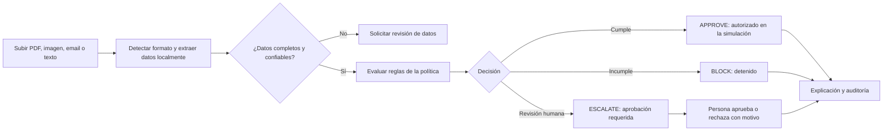

# Blinka Guard

<p align="center">
  <strong>Un agente local para revisar facturas con reglas claras y decisiones auditables.</strong>
</p>

<p align="center">
  
  
  
  
</p>

Blinka Guard es un prototipo local para el reto de Hackatón 30X. Recibe facturas ficticias, extrae sus datos, los contrasta con las reglas de una empresa y decide si cada caso queda **aprobado para pago en la simulación**, **bloqueado** o **escalado a una persona**. Registra la explicación y el historial de cada decisión.

> **Para quien evalúa:** la forma más sencilla de probarlo es iniciar Docker Desktop y ejecutar `docker compose up --build -d` desde la carpeta raíz. No hace falta instalar Python, Node.js, Tesseract ni dependencias del proyecto en el equipo anfitrión.

## Recorrido de la aplicación



El flujo automatiza el ingreso y la evaluación de facturas legibles. Una lectura incompleta o ambigua se detiene para revisión; no se aprueba automáticamente. Los casos que exceden el umbral configurado se muestran en **Aprobaciones** para que una persona decida y registre el motivo.

## Ejecutar la demo con Docker

### Requisitos

- Docker Desktop instalado y abierto, con el motor de contenedores iniciado.
- Conexión a Internet la primera vez, para descargar las imágenes base y dependencias durante la construcción.
- Navegador web moderno.

No se requieren instalaciones separadas de Python, Node.js, pnpm ni Tesseract en Windows/macOS/Linux. Docker compila el backend y el frontend dentro de sus imágenes. El contenedor backend trae Tesseract OCR y los modelos de idioma inglés y español.

### Iniciar

Abre PowerShell, Terminal o la terminal de VS Code **en la raíz del repositorio** (la carpeta que contiene `docker-compose.yml`) y ejecuta:

```powershell
docker compose up --build -d
```

La primera construcción puede tardar unos minutos. Comprueba que los servicios estén iniciados:

```powershell
docker compose ps
```

Abre la aplicación:

- **Aplicación:** <http://localhost:3000>
- **API interactiva (Swagger):** <http://localhost:8000/docs>
- **Estado de la API:** <http://localhost:8000/api/v1/health>

En la interfaz, entra a **Pruebas locales** y pulsa **Cargar datos de prueba** para preparar una política USD y tres facturas sintéticas. Después puedes revisar Facturas, Aprobaciones y Registro de actividad. Para usar el conjunto completo de 12 archivos, mantente en ese espacio y carga los documentos desde `synthetic-invoices/`; el [README del corpus](synthetic-invoices/README.md) describe los casos y el orden requerido para demostrar el límite de presupuesto.

Para ver la salida de los contenedores:

```powershell
docker compose logs -f backend frontend
```

Detén la aplicación conservando el estado local:

```powershell
docker compose down
```

El estado se guarda en el volumen de Compose `blinka-data` (Docker suele añadirle el prefijo del proyecto, por ejemplo `blinka-guard_blinka-data`), separado de los archivos locales ignorados por Git. **No ejecutes `docker compose down -v` salvo que quieras borrar permanentemente ese volumen y todos los datos guardados en él.**

### Compartir la demo con otra persona

Comparte el repositorio o una copia de los archivos versionados, incluyendo `docker-compose.yml`, `backend/`, `frontend/` y `synthetic-invoices/`. La persona instala Docker Desktop, abre la carpeta en una terminal y ejecuta los comandos de inicio anteriores. No empaquetes `.env`, `.venv`, `frontend/node_modules`, cachés ni archivos `runtime_state.json`/`test_state.json`; Docker genera las dependencias y los estados localmente. La primera ejecución necesita Internet; una vez construidas las imágenes, los siguientes inicios no reconstruyen salvo que se solicite `--build`.

## Qué recibe y cómo decide

La carga acepta varios documentos en lote:

| Formato | Lectura local | Requisito OCR |
| --- | --- | --- |
| PDF con texto | Extracción de texto del PDF | No |
| Imagen PNG/JPG | OCR mediante Tesseract | Sí; viene instalado en Docker |
| Correo `.eml` | Lectura del mensaje y su cuerpo | No |
| Texto `.txt` | Lectura UTF-8 y detección de correo/chat | No |

Al procesar cada documento, el sistema detecta el canal, extrae campos como proveedor, referencia, importe, moneda y vencimiento, registra la factura y la evalúa con la política compatible. Los casos incompletos o ambiguos quedan para revisión. Las decisiones incluyen códigos de regla y explicación; las solicitudes escaladas requieren intervención humana.

### Reglas que demuestra el corpus

El conjunto ficticio incluye aprobaciones normales, duplicados, proveedor no autorizado, límite por factura, presupuesto excedido, discrepancia con términos acordados, aprobación humana y datos ambiguos. Para ver el presupuesto excedido de forma reproducible, el sistema debe acumular primero los casos aprobados que se indican en el README del corpus.

El presupuesto es el **acumulado de importes aprobados guardados en la política/espacio de trabajo**. En esta versión no tiene reinicio mensual automático; el ciclo y su reinicio son parte de la configuración de demostración, no un proceso de calendario.

## Tecnologías y dependencias

| Componente | Tecnología | Para qué se usa |
| --- | --- | --- |
| Interfaz web | Next.js, React, TypeScript | Carga de documentos, políticas, aprobaciones y auditoría |
| API | Python 3.11+, FastAPI, Pydantic | Validación, evaluación de reglas y endpoints HTTP |
| Lectura documental | pypdf, Pillow, pytesseract, Tesseract OCR | PDF, imágenes, correo y texto; OCR de imágenes local |
| Persistencia | Archivos JSON locales | Guardar estado operativo, estado de pruebas y auditoría |
| Empaquetado | Docker Compose | Construir y ejecutar frontend, backend y OCR |

Las dependencias de Python están declaradas en `backend/pyproject.toml`; las de frontend y sus versiones bloqueadas están en `frontend/package.json` y `frontend/pnpm-lock.yaml`. Docker las instala durante la construcción. En tiempo de ejecución la aplicación no necesita una API de terceros, un LLM, una base de datos remota, un servicio cloud, una cuenta bancaria ni un proveedor de pagos. El navegador se conecta a la API local.

## OCR: Docker y ejecución sin Docker

**Con Docker:** sí, el OCR queda listo al ejecutar Docker. `backend/Dockerfile` instala Tesseract junto con los modelos `eng` y `spa`; no hay que instalarlo en el equipo anfitrión. Después de reconstruir y arrancar, se pueden subir imágenes como cualquier otro documento.

**Sin Docker en Windows:** hace falta instalar Tesseract por separado, además de Python 3.11. El backend usa `pytesseract` como puente hacia el programa Tesseract; instalar solamente el paquete Python no instala el motor OCR. Para PDFs con texto, `.eml` y `.txt`, Tesseract no es necesario. La guía de instalación de Tesseract está [aquí](https://tesseract-ocr.github.io/tessdoc/Installation.html#windows).

## Solución rápida de problemas

- **`docker` no se reconoce o aparece un error de conexión al motor:** abre Docker Desktop, espera a que indique que el motor está iniciado y vuelve a abrir la terminal.
- **La aplicación no carga en `localhost:3000`:** desde la raíz revisa `docker compose ps` y `docker compose logs -f backend frontend`. El frontend espera a que la API pase su healthcheck.
- **El puerto ya está en uso:** cierra otra aplicación que use el puerto `3000` o `8000` y vuelve a ejecutar `docker compose up --build -d`.
- **Cambiaste código y no ves los cambios en Docker:** reconstruye con `docker compose up --build -d` y recarga el navegador.
- **Una imagen no se lee:** confirma que estás ejecutando el servicio Docker actualizado (`docker compose up --build -d`) y prueba una imagen nítida, derecha y con texto legible. El resultado OCR puede necesitar corrección humana.
- **Quieres limpiar datos de la demo:** reinicia el espacio **Pruebas locales** desde la aplicación. Eso conserva el espacio operativo. `docker compose down -v` borra todo el volumen de datos Docker.

## Ejecutar sin Docker (desarrollo)

Esta opción sí requiere Python 3.11, Node.js 20.9 o superior y pnpm 11 (o npm). Para OCR de imágenes en Windows también se requiere Tesseract local.

### Backend — terminal 1, desde la raíz

```powershell
py -3.11 -m venv .venv
.\.venv\Scripts\python.exe -m pip install -e ".\backend[dev]"
if (-not (Test-Path .env)) { Copy-Item .env.example .env }
.\.venv\Scripts\python.exe -m uvicorn app.main:app --app-dir backend --reload --env-file .env
```

Si Windows no reconoce `py -3.11`, usa `python -m venv .venv`. El entorno virtual está en la raíz; estos comandos usan el ejecutable directamente y no necesitan activarlo.

### Frontend — terminal 2

```powershell
Set-Location .\frontend
pnpm install
if (-not (Test-Path .env.local)) { Copy-Item .env.local.example .env.local }
pnpm dev
```

Si no tienes pnpm, usa npm: `npm install` y luego `npm run dev`. El cliente local usa por defecto `http://127.0.0.1:8000/api/v1`.

## Persistencia, privacidad y límites

- `backend/data/runtime_state.json`: estado operativo en ejecución local sin Docker.
- `backend/data/test_state.json`: estado aislado de **Pruebas locales** en ejecución local sin Docker.
- Con Docker, ambos estados se guardan dentro del volumen `blinka-data`; no se incluyen en el repositorio.
- Los binarios cargados se procesan en memoria y no se guardan; el texto extraído y los datos necesarios para explicar la decisión sí quedan en el estado local.
- El corpus de `synthetic-invoices/` es ficticio. Usa únicamente estos datos para la demostración.
- `APPROVE` significa autorizado dentro de la simulación. La aplicación no mueve dinero ni crea pagos reales.
- No verifica identidad empresarial, fraude o cumplimiento regulatorio; no ofrece autenticación productiva.
- La persistencia JSON es para una instancia local, no para varios workers, equipos conectados o producción pública.

## Organización del repositorio

```text
backend/             API, dominio, evaluación, persistencia local, scripts y pruebas
frontend/            Aplicación Next.js + TypeScript
synthetic-invoices/  12 documentos sintéticos, política y manifiesto de resultados
docs/                Alcance del producto, arquitectura, seguridad e historial de trabajo
docker-compose.yml   Inicio local coordinado de API y frontend
AGENTS.md            Contexto de continuidad para el equipo y agentes de desarrollo
```

Para entender el alcance, arquitectura y controles, consulta [alcance del producto](docs/PRODUCT_SCOPE.md), [arquitectura](docs/architecture/ARCHITECTURE.md) y [seguridad](docs/security/SECURITY.md). El [registro de trabajo](docs/WORK_LOG.md) conserva el historial de implementación.
