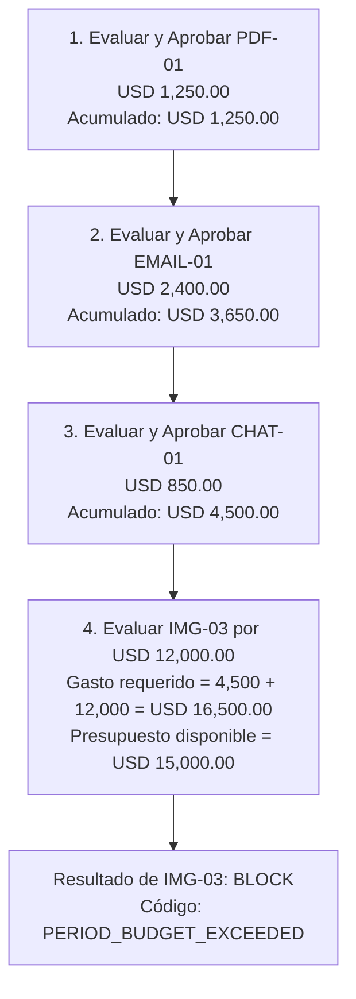

# Paquete de Documentos Sintéticos — Cuentra

> [!IMPORTANT]
> **Aviso de confidencialidad y datos sintéticos:**
> Todos los datos, entidades corporativas, nombres de fantasía, personas, importes, identificadores, direcciones de correo y números de orden contenidos en este paquete son **100% sintéticos y ficticios**. Han sido generados exclusivamente para pruebas de desarrollo, evaluación de reglas de negocio, extracción documental y demostraciones de Cuentra. No corresponden a ninguna persona, empresa o transacción real.

---

## 1. Resumen del paquete

Este paquete contiene **12 artefactos fuente sintéticos** distribuidos en cuatro medios diferentes (3 PDF, 3 imágenes PNG, 3 correos `.eml` y 3 transcripciones de chat `.txt`), acompañados de la política de evaluación corporativa en dólares (`company_policy_usd.json`) y el catálogo maestro de metadatos y resultados esperados (`manifest.json`).

- **Empresa compradora destinataria:** `Northstar Field Operations LLC` (empresa ficticia con operaciones en Latinoamérica).
- **Moneda base:** `USD` (todas las evaluaciones se realizan en USD sin conversión cambiaria).
- **Parámetros de política corporativa:**
  - Importe máximo permitido por factura: **USD 20,000.00**
  - Presupuesto del periodo: **USD 15,000.00**
  - Umbral de aprobación humana obligatoria: **USD 5,000.00** (facturas $\ge$ USD 5,000.00 escalan a revisión)
  - Proveedores aprobados en política:
    - `Andes Field Services LLC`
    - `Río Claro Creative Studio SAS`
    - `Pacific Ledger Support LLC`
  - Proveedor no autorizado (fuera de lista): `Selva Norte Consulting SAS`
  - Término de acuerdo preconfigurado: `Pacific Ledger Support LLC` + `NS-PO-902` por **USD 4,200.00**.

---

## 2. Matriz de los 12 artefactos sintéticos

| ID | Archivo fuente | Medio / Formato | Proveedor | Referencia | Importe (USD) | Vencimiento | Resultado esperado | Códigos de motivo esperados | Escenario evaluado |
|---|---|---|---|---|---|---|---|---|---|
| **PDF-01** | `PDF-01-valid-auto-approve.pdf` | PDF (vectorial) | Andes Field Services LLC | `NS-INV-4101` | $1,250.00 | 2026-11-15 | `APPROVE` | `POLICY_CHECKS_PASSED` | Caso nominal válido por debajo del umbral humano ($5,000) y dentro del presupuesto. Aprobación automática. |
| **PDF-02** | `PDF-02-duplicate-invoice.pdf` | PDF (vectorial) | Andes Field Services LLC | `NS-INV-4101` | $1,250.00 | 2026-11-15 | `BLOCK` | `DUPLICATE_INVOICE` | Caso trampa de duplicado. Coincide exactamente en proveedor y número de factura con PDF-01. |
| **PDF-03** | `PDF-03-human-approval.pdf` | PDF (vectorial) | Río Claro Creative Studio SAS | `NS-INV-4103` | $7,800.00 | 2026-11-28 | `ESCALATE` | `HUMAN_APPROVAL_REQUIRED` | Proveedor permitido y dentro del máximo ($20,000), pero $\ge \$5,000.00$. Requiere aprobación humana. |
| **IMG-01** | `IMG-01-unapproved-vendor.png` | Imagen PNG | Selva Norte Consulting SAS | `NS-INV-4201` | $980.00 | 2026-11-18 | `BLOCK` | `VENDOR_NOT_ALLOWED` | Proveedor no registrado en la lista de proveedores autorizados de la política. Bloqueo inmediato. |
| **IMG-02** | `IMG-02-invoice-limit.png` | Imagen PNG | Pacific Ledger Support LLC | `NS-INV-4202` | $22,450.00 | 2026-12-02 | `BLOCK` | `INVOICE_LIMIT_EXCEEDED` | Factura individual que supera el tope máximo de la política ($20,000.00). |
| **IMG-03** | `IMG-03-budget-exceeded.png` | Imagen PNG | Andes Field Services LLC | `NS-INV-4203` | $12,000.00 | 2026-11-30 | `BLOCK` | `PERIOD_BUDGET_EXCEEDED` | Dentro del tope por factura, pero al evaluarse con $4,500.00 previamente aprobados, la suma ($16,500) excede los $15,000 de presupuesto. |
| **EMAIL-01** | `EMAIL-01-valid-auto-approve.eml` | Correo RFC 822 | Río Claro Creative Studio SAS | `NS-INV-4301` | $2,400.00 | 2026-11-20 | `APPROVE` | `POLICY_CHECKS_PASSED` | Caso nominal recibido por correo electrónico; proveedor autorizado y datos coherentes. Aprobación automática. |
| **EMAIL-02** | `EMAIL-02-terms-mismatch.eml` | Correo RFC 822 | Pacific Ledger Support LLC | `NS-INV-4302` | $4,800.00 | 2026-11-25 | `BLOCK` | `AGREEMENT_AMOUNT_MISMATCH` | Factura que cita la orden `NS-PO-902` por $4,800.00. La política independiente define $4,200.00; bloquea por discrepancia de acuerdo. |
| **EMAIL-03** | `EMAIL-03-human-approval.eml` | Correo RFC 822 | Andes Field Services LLC | `NS-INV-4303` | $6,250.00 | 2026-12-05 | `ESCALATE` | `HUMAN_APPROVAL_REQUIRED` | Factura formal por correo electrónico con importe $\ge \$5,000.00$. Escala a revisión humana. |
| **CHAT-01** | `CHAT-01-valid-auto-approve.txt` | Chat UTF-8 | Andes Field Services LLC | `NS-INV-4401` | $850.00 | 2026-11-22 | `APPROVE` | `POLICY_CHECKS_PASSED` | Mensaje estructurado de mensajería instantánea. Caso nominal de aprobación automática ($850 < $5,000). |
| **CHAT-02** | `CHAT-02-human-approval.txt` | Chat UTF-8 | Río Claro Creative Studio SAS | `NS-INV-4402` | $5,400.00 | 2026-12-08 | `ESCALATE` | `HUMAN_APPROVAL_REQUIRED` | Mensaje de chat estructurado con importe $\ge \$5,000.00$. Escala a revisión humana. |
| **CHAT-03** | `CHAT-03-ambiguous-data.txt` | Chat UTF-8 | Andes Field Services LLC | `NS-INV-4403` | `null` | 2026-11-25 | `null` | `EXTRACTION_UNCERTAIN_DATA`, `MANUAL_REVIEW_REQUIRED` | Referencia y fecha legibles, pero total ambiguo (`1,2xx`) y sin código ISO de moneda. Extracción incompleta; no autoaprobar jamás. |

---

## 3. Instrucciones de preparación de estado y orden determinista

### 3.1. Evaluación determinista del presupuesto de periodo

El presupuesto de periodo de **USD 15,000.00** no se puede inferir del importe de una factura aislada, sino del acumulado de gastos aprobados en el sistema durante el ciclo. Para probar de forma reproducible el caso **IMG-03** (`PERIOD_BUDGET_EXCEEDED`), el estado de la aplicación debe prepararse en el siguiente orden secuencial estricto:



1. **Paso 1:** Evaluar y registrar como aprobada `PDF-01` ($1,250.00 \text{ USD}). \text{ Gasto aprobado acumulado } $$= 1,250.00 \text{USD}$.
2. **Paso 2:** Evaluar y registrar como aprobada `EMAIL-01` ($2,400.00 \text{ USD}). \text{ Gasto aprobado acumulado } $$= 3,650.00 \text{ USD}$.
3. **Paso 3:** Evaluar y registrar como aprobada `CHAT-01` ($850.00 \text{ USD}). \text{ Gasto aprobado acumulado } $$= 4,500.00 \text{ USD}$.
4. **Paso 4:** Evaluar la factura `IMG-03` ($12,000.00 \text{ USD}) \text{ contra la política: }
   $$\text{Gasto Aprobado} + \text{Factura} = \$4,500.00 + \$12,000.00 = \$16,500.00 > \$15,000.00$$
   El motor emitirá la decisión `BLOCK` con el motivo `PERIOD_BUDGET_EXCEEDED`.

> [!NOTE]
> **Detalle técnico sobre términos de proveedor (`vendor_terms`):**
> El motor exige referencia para facturas de un proveedor con términos configurados. CHAT-01 usa Andes Field Services LLC, que no tiene términos configurados, para que el caso normal pueda aprobarse sin excepción y mantener reproducible la suma de USD 4,500.00.

### 3.2. Evaluación de términos y acuerdos preexistentes (EMAIL-02)

Para evaluar el caso trampa de discrepancia de términos:
1. La política corporativa (`company_policy_usd.json`) define de forma independiente:
   ```json
   {
     "vendor_name": "Pacific Ledger Support LLC",
     "agreement_reference": "NS-PO-902",
     "currency": "USD",
     "agreed_amount": "4200.00"
   }
   ```
2. El documento entrante (`EMAIL-02-terms-mismatch.eml`) contiene en su cuerpo la referencia `Purchase Order: NS-PO-902`, pero factura **USD 4,800.00**.
3. El sistema extrae la referencia `NS-PO-902`, busca la regla pactada en la política corporativa ($4,200.00 \text{ USD}) \text{ y detecta que } \$4,800.00 \ne \$4,200.00.$
4. Resultado: `BLOCK` con código `AGREEMENT_AMOUNT_MISMATCH`. La información del correo entrante **nunca** sobreescribe el valor autorizado en la política.

---

## 4. Características técnicas de los medios

### Facturas PDF (`.pdf`)
- Generados como documentos PDF 1.4 reales con texto vectorial seleccionable (sin imágenes estáticas embebidas).
- Compatibles con extracción vía `pypdf`, `pdfplumber` o `pdfminer`.
- Contienen encabezado comercial, datos de emisor, destinatario, fecha de emisión, vencimiento, desglose de servicios y total con etiquetas normalizadas (`Supplier:`, `Invoice Number:`, `Total Due:`, `Due Date:`).

### Facturas en Imagen (`.png`)
- Imágenes nítidas de $1000 \times 1300$ px, texto de alto contraste negro sobre blanco con tipografía TrueType (Arial).
- Sin artefactos de compresión, distorsiones de perspectiva ni sombras, listas para lectura mediante OCR local (Tesseract OCR) o inspección manual.
- Etiquetas alineadas con los patrones del ingestor: `Supplier:`, `Invoice Number:`, `Total Due:`, `Due Date:`.

### Facturas por Correo (`.eml`)
- Formato estándar MIME / RFC 822 con codificación UTF-8.
- Dominios de correo estrictamente ficticios bajo el TLD reservado `.test` (`@rioclarostudio.example.test`, `@pacificledgersupport.example.test`, `@andesfieldservices.example.test`).
- Cuerpo en texto plano con etiquetas normalizadas y explicación contextual de los servicios prestados.

### Conversaciones de Chat (`.txt`)
- Archivos de texto plano codificados en UTF-8 con marcas temporales y participantes identificados.
- Contienen bloques estructurados con las etiquetas clave requeridas por el extractor.
- `CHAT-03` incluye deliberadamente una ambigüedad sintética (`Total Due: 1,2xx (tarifa pendiente de ajuste, sin definir si corresponde a dolares o pesos)`) que provoca la ausencia de los campos `amount` y `currency` en la extracción, impidiendo cualquier autoaprobación y forzando la intervención humana.

---

## 5. Instrucciones de uso y prueba

### Extracción de campos mediante la API
Para probar la extracción de campos sugeridos en un documento cualquiera:

```bash
curl -X POST "http://127.0.0.1:8000/api/v1/documents/extract" \
  -F "file=@synthetic-invoices/PDF-01-valid-auto-approve.pdf"
```

Respuesta típica JSON:
```json
{
  "source_filename": "PDF-01-valid-auto-approve.pdf",
  "source_type": "pdf",
  "fields": {
    "external_reference": "NS-INV-4101",
    "vendor_name": "Andes Field Services LLC",
    "amount": "1250.00",
    "currency": "USD",
    "due_date": "2026-11-15",
    "agreement_reference": null
  },
  "missing_fields": [],
  "warnings": [],
  "ready_for_review": true,
  "auto_approval_allowed": false
}
```

### Carga de la política en la API
```bash
curl -X POST "http://127.0.0.1:8000/api/v1/policies" \
  -H "Content-Type: application/json" \
  -d @synthetic-invoices/company_policy_usd.json
```
